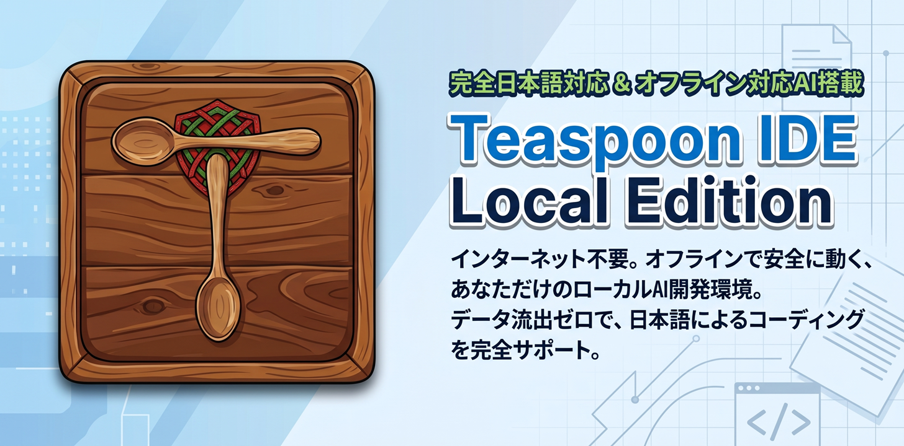

# Teaspoon IDE Local Edition（Teaspoon LE）

<p align="center">
  
</p>

**Teaspoon IDE Local Edition** は [Teaspoon IDE](https://github.com/cuculhart/teaspoon-ide) のフォークです。ファイルエクスプローラー、コードエディター、AIチャット、Git操作、ターミナルが一体となった、スタンドアロン型のElectron製AIコーディングアシスタントを、**オフライン・ローカル完結**向けに再構成したものです。

- **完全日本語＆オフライン対応。** UI・メニュー・ダイアログ・AIの応答はすべて日本語。LANケーブルを抜いても、Wi-Fiを切っても動作します。
- **外部送信なし・データ収集なし。** AIバックエンドはローカルの [Ollama](https://ollama.com) サーバー（`localhost:11434`）のみ。プロンプト・コードが外部に送信されることはありません。
- **情シス部門に説明しやすい。** アカウント・テレメトリ・外部エンドポイントがなく、監査対象は Ollama（MIT）と本アプリだけです。

**Teaspoon** の名前は「小さじ1杯（a teaspoon）のトークンで実用的な仕事をこなす」という設計目標に由来します。デフォルトで送信するコンテキストはファイルツリー（パス一覧）のみで、AI は READ_FILE/GREP を通じて必要な内容だけを取得し、メッセージあたりのトークンを抑えます。

上流リリースの追従は行わない、独立したフォークです。

Author: Cuculhart — Web Site: https://cuculhart.com

## 主な機能

### プロジェクト管理

- **プロジェクトを開く**: フォルダ選択ダイアログから任意のフォルダをプロジェクトとしてオープン
- **プロジェクト新規作成**: プロジェクト名と親フォルダを指定して新規作成
- **Recent Projects**: よく開く順（オープン回数+最近順）で一覧表示し、ワンクリックでオープン
- **セッション復元**: リロードや再起動後に、最後に開いていたプロジェクト・ファイル・チャット履歴を自動復元
- **ファイル/フォルダ作成**: エクスプローラーの📄+/📁+ボタンまたはメニューからインライン作成
- **ドラッグ&ドロップ**: exeやアプリウィンドウにフォルダをドロップするとプロジェクトとしてオープン（`Teaspoon.exe <path>` でも可。二重起動時は既存インスタンスに引き渡し）

### エディター

- **Monaco Editor**: 言語自動検出、ミニマップ、シンタックスハイライト
- **保存**: Ctrl+S / File > Save
- **Undo/Redo**: メニューおよびショートカット対応（Monaco内部履歴と連携）
- **差分ビュー**: Gitパネルの変更ファイルをクリックするとHEADとのside-by-side diffを表示
- **クイックオープン**: Ctrl+P（File > Quick Open）でファイル名ファジー検索、最近開いたファイル一覧表示
- **全文検索**: サイドバー「Search」タブでプロジェクト横断検索（正規表現対応）、結果クリックで該当行にジャンプ

### AIチャット

- **エージェントループ**: AIがファイル操作コマンドを発行し、結果をフィードバックしながら複数ステップで自律作業（一覧取得 → 読み込み → 編集）
- **相談モード（読み取り専用）**: チャットヘッダーのモードボタンで「コード」⇔「相談」を切替。相談モードでは AI は READ_FILE / GREP 等でプロジェクトを調査できますが、WRITE_FILE / EDIT_FILE / RUN_COMMAND / CLOSE_PROJECT はプロンプトと実行層の両方でブロックされ、コードレビューや問題点の指摘など「読むだけ」の相談に使えます
- **コンテキスト管理**: デフォルトではファイルツリー（パス一覧）のみを送信してトークンを節約し、AIがREAD_FILE/GREPで必要に応じて内容を取得。🧠ボタンで手動ファイル選択モードに切替可能。モードと上限はSettings > AI Contextで設定可能
- **安全な書き込み制御**: 書き込みはプロジェクトルート内に限定。外部への書き込みは拒否
- **プロジェクト別チャット永続化**: プロジェクトごとに会話をlocalStorageに保存し、再オープン時に復元
- **チェックポイント&ロールバック**: AI書き込み前にスナップショットを取得。「↩ Rollback」でAIが触ったファイルのみ復元
- **プロジェクト作成プロンプト**: プロジェクト未オープン時にAIがファイル書き込みを試みると、プロジェクトフォルダ作成ダイアログ（既定の親フォルダ: Documents）を表示し、そのままファイル操作を継続
- **Retryボタン**: 最後の回答を再生成
- **キャンセル・タイムアウト・応答長制限** 対応済み

### Git

- **Source Controlパネル**: ブランチ表示、ahead/behindカウント、変更ファイル一覧（ステータスバッジ付き）
- **ステージ＆コミット**: チェックボックスで対象選択、または全変更を一括コミット
- **Push / Pull**: ツールバーから実行。対象リモートが一意に決まる初回pushではupstreamを自動設定
- **クローン**: プロジェクトを開くダイアログからリポジトリURLを指定、または空の開いているプロジェクトフォルダへクローン
- **リモート設定**: リモートの追加・更新、必要時の初回コミット作成、upstream設定付きのブランチpushに対応
- **リポジトリ初期化**: 非Gitフォルダに対して `git init` を実行可能
- **Git設定**: `user.name` と `user.email` をグローバルまたはリポジトリ単位で設定

### ターミナル

- **コマンド実行**: プロジェクトルートをカレントディレクトリとしてコマンドを実行（`npm install`、`npm start`、`docker compose up` 等）
- **複数プロセス同時管理**: 長時間プロセスを動かしたまま別コマンドを実行可能
- **真のTTY（node-pty + xterm.js）**: 対話型CLIプログラム（入力待ちゲーム、REPL等）にキー入力を送信可能。ANSIカラー・カーソル操作も描画
- **プロセス停止**: Stopボタンでプロセスツリーごと終了（Windowsではtaskkill /T /F相当）
- **URL検出**: 出力中の `http://localhost:...` をクリックするとブラウザで開く
- **AIからのコマンド実行**: `// RUN_COMMAND:` コマンドを発行可能。必ずユーザー承認を挟み、stdout/stderrと終了コードをAIにフィードバック

### Markdown

- **プレビュー**: `.md` ファイルをエディターヘッダーで Preview/Edit 切替（marked + DOMPurify、GFM対応）
- **エクスポート**: スタイル埋め込みの単一HTMLファイルまたはPDF（Electron `printToPDF`）へ出力 — エディターヘッダーまたはFileメニューから。拡張機能やPandoc不要

### 外観・設定

- **テーマ**: System（OS設定連動、nativeTheme経由）/ Dark / Light に加え、オフィス向けのカラーテーマ: Organic Light、Heritage、Ancient Console
- **フォント**: ファミリー・サイズをUI全体とMonacoエディターに反映
- **Ollama（ローカルAI）**: 唯一のバックエンド。`localhost:11434` 固定で接続先の設定項目はありません。モデルはローカルにインストール済みのものから選択（推奨: `gemma4:e4b`）。CPU Threads（推論スレッド数の上限）、Context Size（num_ctx）、Temperature、Thinking を設定可能。いずれもOllamaネイティブの `/api/chat` オプション経由
- **UI言語**: 日本語固定
- **チャットフォーカス**: チャットヘッダーのフォーカス切替ボタン（入るとき⛶、戻るとき◫）または View > Toggle Chat Focus（Ctrl+Shift+B）でサイドバー・エディター・ターミナルを隠し、チャットを全画面表示。IDE系のメニュー操作時は自動で復帰し、状態は再起動後も保持
- **チャットリスト**: チャットフォーカス中は会話一覧レールが表示され（一覧｜会話の2ペイン）、チャットを切り替えられる。履歴はプロジェクト未オープンの会話を含め会話単位で userData/chat-history 配下のJSONに永続化。長い会話は古い部分をローリング要約に畳み込み、モデルのコンテキスト上限内に収める
- **ドキュメント**: Help メニューから「リファレンスマニュアル」「ハンズオンガイド」（PDF）を開けます。ソースは `docs/` にあり、`npm run docs:pdf` で再生成できます
- **About**: Help > About Teaspoon IDE Local Edition
- **ネイティブメニュー**: File / Edit / View / Window / Help

## アーキテクチャ

```
Electron アプリ
├── メインプロセス (Node.js)
│   ├── ウィンドウ管理・ネイティブメニュー
│   ├── ファイルシステムアクセス
│   ├── フォルダ選択ダイアログ
│   ├── nativeTheme（テーマ連携）
│   ├── ターミナル/PTY (node-pty)
│   └── Git操作 (simple-git)
├── レンダラープロセス (React/TypeScript)
│   ├── エクスプローラー / Gitパネル / Search（サイドバータブ）
│   ├── エディターペイン (Monaco / DiffEditor)
│   ├── チャットペイン（エージェントループ）
│   ├── ターミナルペイン (xterm.js)
│   └── コンテキスト管理 / i18nサービス
└── LLM統合
    └── Ollama on localhost:11434（ローカル・オフライン）
        └── ファイル操作コマンド（エージェントループ）
```

## セキュリティ・ネットワークモデル

Local Edition には**クラウド経路が一切ありません**：

- レンダラーが通信するのは `http://localhost:11434`（Ollama の `/api/chat` と `/api/tags`）のみ。接続先・プロキシの設定項目も、資格情報の保存機構もありません。
- Electron メインプロセスの LLM リレー、シークレットストア、組織（マネージド）モードは上流版から完全に削除しています。
- Ollama のローカルAPIには認証がないため、`127.0.0.1` バインド（既定）を維持し、ポート11434をLANに公開しないでください。
- 外部への通信を完全に断ちたい環境では、Ollama サービスに `OLLAMA_NO_CLOUD=1` を設定するか、Ollama のアウトバウンドをブロックするファイアウォール規則を追加してください。モデルファイルは接続可能なマシンで `ollama pull` してからコピーする必要があります。

## 配布・運用モデル

このアプリはソース公開型（source-available）ソフトウェアとしてスタンドアロン配布することを想定しています（ライセンスは FSL-1.1-MIT。詳細は「ライセンス」節を参照）。

- **開発時**: `npm run dev` で Vite dev server（localhost:5173）+ Electron を起動
- **配布時**: Electron Forgeでパッケージ化。ユーザーはインストーラー/zipをローカルにダウンロードして実行（dev server不要）

### CSPポリシーについて

`index.html` のContent Security Policyは `localhost` への接続を許可していますが、これは「許可リスト」であり接続を必須にするものではありません。パッケージ版でも害はなく、Ollamaプロバイダー（`http://localhost:11434`）への接続を可能にします。

### チャットとプロジェクトの関係

現在は「1プロジェクト : 1チャット」で、会話は `userData/chat-history` 配下のJSONファイルとして永続化されます（プロジェクト未オープンの会話を含む）。内部的にはプロジェクト→会話リストの構造で保持しているため、複数チャットタブ（1プロジェクト : nチャット）への拡張が容易です。

### パッケージ化

`npm run package` で `out/Teaspoon-win32-x64/Teaspoon.exe`（ポータブル実行ファイル）、`npm run make` でインストーラー（Squirrel）を生成します。

実施済みの対応：

- `electron/main.js` — `app.isPackaged` 時は `dist/index.html` を `loadFile` で読み込み
- CSP — 本番ビルドのみ厳格化（`vite.config.ts` の transformIndexHtml で差し替え。`'unsafe-inline'`スクリプト・CDN・`ws:`を除去）
- Monaco Editor — `monaco-editor` をローカルバンドル化（`src/monacoSetup.ts` でworkerを同梱、CDN依存解消・オフライン動作）
- node-pty — `asar.unpack` で `.node` バイナリをasar外に展開
- メインプロセスの致命的エラーを `%TEMP%/teaspoon-crash.log` に記録（パッケージ版はコンソールが無いため）

## 技術スタック

- **フレームワーク**: Electron + React + TypeScript
- **エディター**: Monaco Editor
- **Git**: simple-git
- **ターミナル**: node-pty + xterm.js
- **LLM**: Ollama on localhost（ローカルのみ）
- **ビルドツール**: Vite + Electron Forge
- **設定管理**: ConfigService + localStorage
- **Node.js**: v22 LTS推奨

## はじめに

### 前提条件

- Node.js v22 LTS（推奨）
- npm
- Git（Gitパネル使用時）

Linux/macOSでディストリビューションのNodeがv22より古い場合は、
バージョン管理ツールでv22を導入してください:

```bash
# 方法A: n
npm install -g n
n 22

# 方法B: nvm
nvm install 22 && nvm use 22
```

### インストール

```bash
git clone https://github.com/cuculhart/teaspoon-ide.git
cd teaspoon-ide

# 依存関係のインストール
npm install

# 開発モードの実行
npm run dev
```

## 使用方法

### プロジェクトを開く / 作成する

1. アプリを起動
2. Explorerの📂ボタンをクリック
3. 「Select Folder」で既存フォルダを選択、または「New Project」で新規作成
4. Recent Projectsからの再オープンや、exe/ウィンドウへのフォルダドロップも可能

### AIチャットを使用する

1. 同じマシンに [Ollama](https://ollama.com) をインストールして起動し、モデルを取得（例: `ollama pull gemma4:e4b`）
2. 設定画面（⚙️）> Ollama で接続とモデルを確認
3. チャットでメッセージを送信 — 応答は既定で日本語です

### コンテキスト管理

- **自動モード**: ファイルツリー（パス一覧）を送信。AIはツール経由で必要に応じてファイル内容を取得
- **手動モード**: エクスプローラーのファイル選択ボタンでAIコンテキストに追加
- 🧠ボタンで自動/手動モードを切替。Settings > AI Context で設定可能

### AIによるファイル操作

AIに「ファイルを作成して」「○○を編集して」と指示すると、AIがファイル操作コマンドを発行し、アプリ側で実行します。

- `// LIST_FILES: <dir>` — ディレクトリ内のファイル一覧を取得
- `// READ_FILE: <path>` — ファイルを読み込み
- `// GREP: <pattern>` — プロジェクト全体を正規表現（または部分一致）で内容検索。`file:line: text`形式で返却
- `// FIND_FILES: <pattern>` — ファイル名/パスをglob（`*.ts`等）または部分一致で検索
- `// WRITE_FILE: <path>` + `// END_WRITE_FILE` — ファイルを作成・上書き（承認ダイアログ経由）
- `// EDIT_FILE: <path>` + `<<<<<<< SEARCH` / `=======` / `>>>>>>> REPLACE` + `// END_EDIT_FILE` — 部分差分編集（複数ブロック可、承認ダイアログ経由）
- `// RUN_COMMAND: <command>` — シェルコマンドを実行（承認ダイアログ経由、PTYで対話型も可）
- `// CLOSE_PROJECT` — プロジェクトを閉じる（引数なし。File > Close Project と同等のため承認不要）

実行結果はAIにフィードバックされるため、AIは複数ステップで自律的に作業し、完了後に自然言語の要約を返します。

**安全性**: 書き込みはプロジェクトルート内のパスに限定されます。プロジェクト外への書き込みは拒否されます。

### Git操作

1. サイドバーの「Git」タブを開く
2. File > Clone Repositoryまたは「プロジェクトを開く」ダイアログからリポジトリをクローン。新規の空プロジェクトでは「このフォルダへクローン」または「Gitを初期化」を選択
3. ⇄でリモートを追加・更新。まだコミットが無い場合は「初回コミット」を実行してから、現在のブランチをupstream設定付きでpush。⚙で `user.name` / `user.email` を設定
4. 変更ファイル一覧を確認（ファイル名クリックでdiff表示）
5. コミットメッセージを入力してCommit（チェックしたファイルのみ、または全変更）
6. ↑/↓ボタンでPush/Pull（リモートが一意に決まる場合、Pushはupstreamも自動設定）

## 開発

```bash
# 開発モード
npm run dev

# 本番用ビルド
npm run build

# プレビュー
npm run preview
```

## ライセンス

**FSL-1.1-MIT（Functional Source License 1.1 / MIT 将来ライセンス）**
— Copyright 2026 Cuculhart（正式な条文は [LICENSE](LICENSE) を参照）

### 平易なまとめ

| | 内容 |
|---|---|
| ✅ 自由にできること | 企業内でのクローン・フォーク・改変・監査・社内利用・非商用の教育/研究利用 |
| ❌ 禁止 | 販売・有償提供・営利目的での利用（**有償セミナーでの利用を含む**）、および Teaspoon LE と同等の機能を持つ商用製品・サービスとしての提供 |
| ⏳ 将来 | 各リリースから **2年後** に自動的に MIT ライセンスへ移行します |

- 「Teaspoon IDE」「Teaspoon LE」の名称・ロゴはライセンスとは独立して管理されます（商標条項：出典表示と作者クレジット以外の使用は不可）
- 改変・再配布する場合は、本ライセンス条項（またはそのリンク）と著作権表示を残してください

Teaspoon LE はオープンソースコンポーネント（Monaco Editor、Electron、React、xterm.js 等）を利用しています。各コンポーネントのライセンスと権利者は [THIRD_PARTY_LICENSES.md](THIRD_PARTY_LICENSES.md) を参照してください。パッケージ版ではこれらのファイルが `resources/` に同梱されます。
